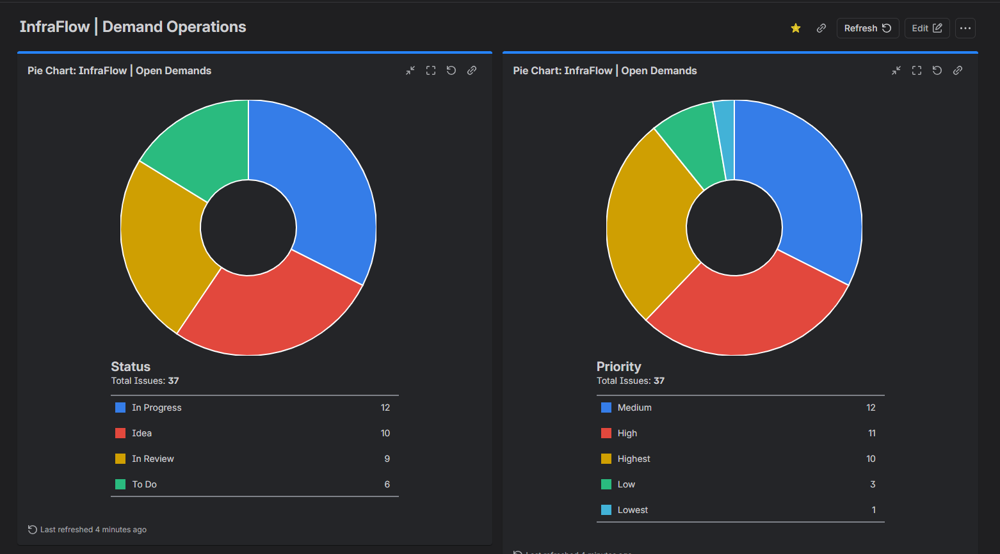
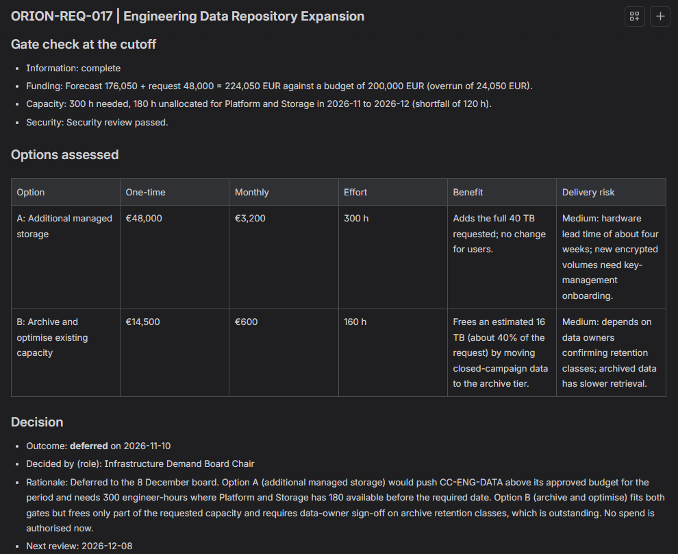
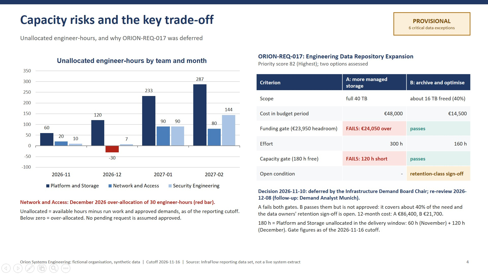
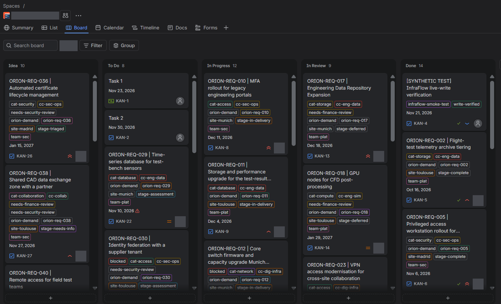
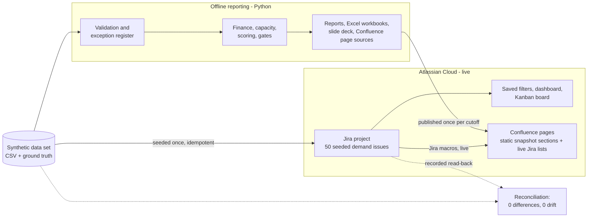
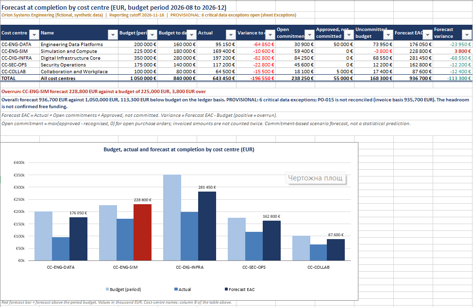

# InfraFlow Mission Control

[](https://github.com/Hyp3rAlex/infraflow-mission-control/actions/workflows/python-validation.yml)
      

**IT infrastructure demand management, end to end: intake in Jira, assessment against budget and team capacity, a recorded human decision, and management reporting in Confluence, Excel and PowerPoint.**

> **Independent portfolio project using entirely synthetic data. All organizations, personnel, infrastructure demands, financial figures, and operational scenarios are fictional. This project is not affiliated with or endorsed by any real organization and has not been deployed in production.**
>
> The fictional organisation is "Orion Systems Engineering". Reporting cutoff **2026-11-16**. Financial figures are **PROVISIONAL**: six critical data exceptions are modelled on purpose and are reported, not hidden.

| 50 | 37 | 5 | 6 |
|:---:|:---:|:---:|:---:|
| synthetic demands in Jira | open at the cutoff | awaiting a board decision | critical data exceptions |

<a href="evidence/screenshots/01-jira-dashboard-status-priority.png"></a>

*Jira Cloud dashboard built on saved JQL filters: the 37 open demands by workflow status and by priority. Every gadget reads the live project; the counts match the offline reports for the same cutoff.*

## What it demonstrates

- **A working collaboration setup.** 50 demand issues in Jira Cloud with a label convention for lifecycle stage, site, team and cost centre; 16 verified JQL queries saved as filters; an eight-gadget dashboard; a Kanban board; a Confluence space with procedures, a decision register, a weekly review and embedded live Jira lists.
- **Decisions that are not automatic.** A priority score orders the review queue. Approval needs funding, capacity, information and security gates and a named human role. The featured request below scores 82/100 and was still deferred.
- **Financial control.** Budget, actuals, open commitments and a commitment-based forecast per cost centre. Invalid rows are excluded *and* listed. A US-dollar invoice is never added to euro totals. An unreconciled purchase order is shown as forecast uncertainty.
- **Reproducible reporting.** One Python pipeline generates 13 Markdown reports, an Excel workbook, an Excel-formula exercise workbook and a five-slide executive deck from the same data. 179 automated tests pass (run them below).

## Featured decision: ORION-REQ-017, deferred despite top priority

The flight-test data team requests 40 TB more encrypted storage by 18 December. Two options were assessed against the cost-centre budget and the storage team's free hours.

| | Option A: more managed storage | Option B: archive and optimise |
|---|---|---|
| Scope | full 40 TB | about 16 TB freed (40%) |
| Cost in the budget period | €48,000 | €14,500 |
| Funding gate (€23,950 headroom) | **fails**: €24,050 over budget | passes |
| Effort vs. 180 h unallocated | **fails**: 300 h, 120 h short | passes: 160 h |
| Open condition | - | data owners' retention-class sign-off |

The board chair **deferred** the request on 2026-11-10 to the 8 December board. A fails both gates; B passes them but covers 40% of the need and depends on an outstanding sign-off. The score set the order of review, not the outcome.

<a href="evidence/screenshots/07-jira-orion017-gates-options-decision.png"></a>

*Jira issue KAN-13: the gate check, both options and the recorded decision are part of the work item, so the reasoning travels with the request. The comment history on the issue reconstructs synthetic lifecycle dates.*

<a href="evidence/screenshots/16-ppt-capacity-decision-slide4.png"></a>

*Executive slide generated from the same data: team capacity, with Network and Access 30 h over-allocated in December (red bar below zero), beside the option trade-off. Full walkthrough with the Confluence decision brief: [case study](docs/CASE_STUDY_ORION_REQ_017.md).*

## Workflow and architecture

<a href="evidence/screenshots/05-jira-kanban-portfolio.png"></a>

*Kanban board of the Jira space. Twelve lifecycle stages map onto five Jira statuses; the exact stage is a `stage-*` label, so JQL stays precise. Four non-portfolio items (three Jira onboarding samples and one integration smoke test) are excluded from every filter by the `orion-demand` label. Personal account details are covered in the published screenshots.*



There is **no live Jira-to-Excel synchronisation**. Money and hours are not stored in Jira; the financial figures in Excel, PowerPoint and the static Confluence sections come from the offline data set. Jira is compared with that data set through recorded snapshots. Details: [architecture](docs/ARCHITECTURE.md).

## Reporting and financial guardrails

<a href="evidence/screenshots/14-excel-forecast-workbook.png"></a>

*Generated Excel workbook, Forecast sheet, opened in Microsoft Excel. Forecast at completion €936,700 against a €1,050,000 budget; CC-ENG-SIM is €3,800 over. The provisional note stays on the sheet. The small floating label in the chart is an Excel tooltip captured with the screenshot.*

| Rule | Implementation |
|---|---|
| No double counting | Open commitment = max(approved - recognised, 0) for open purchase orders; invoiced amounts are actuals |
| No currency mixing | Only EUR is totalled; USD 5,000 (INV-9006) has no approved rate and is reported in USD; summing mixed currencies raises an error |
| Nothing dropped silently | Invalid EUR invoices (€4,300 gross), unmapped spend (€4,300) and the PO-015 mismatch (€1,000) are listed with owner and due date |
| Provisional, not hidden | Six critical exceptions keep every report marked PROVISIONAL; the €113,300 headroom is "not confirmed free funding" |

Methodology: [financial methodology](docs/FINANCIAL_METHODOLOGY.md). More evidence, including team capacity, the Confluence weekly review and all five slides: [demonstration gallery](docs/DEMO.md).

## Verification

| Check | Evidence |
|---|---|
| 179 automated tests: lifecycle controls, gates, finance against an independent ground truth and a hand-calculated ledger, currency separation, capacity what-if, reports, Office files, Jira client (mocked) | `python -m pytest`, [testing](docs/TESTING.md) |
| Jira issues equal the data set, field by field | 50 issues read back: 0 differences ([evidence](evidence/README.md)) |
| 16 JQL queries return exactly the expected issues | live run, 16/16 ([JQL catalogue](docs/JQL_FILTERS.md)) |
| Saved filters and dashboard exist | read live 2026-11-18: 18 filters, all 16 catalogue queries saved, dashboard present; one extra filter has a wrong query ([limitations](docs/LIMITATIONS.md)) |
| Excel formulas agree with Python | Microsoft Excel calculated 27/27 check cells OK in the exercise workbook |
| Builds are reproducible | regenerated data and Office files are byte-identical |

## Quick start

Requires Python 3.12+. No credentials or network access needed.

```bash
python3 -m venv .venv && .venv/bin/pip install -e ".[dev]"
.venv/bin/python -m pytest -q                       # 179 tests
.venv/bin/python -m infraflow seed                  # regenerate the synthetic data (byte-identical)
.venv/bin/python -m infraflow validate              # exception register
.venv/bin/python -m infraflow all                   # reports, both workbooks, slide deck
.venv/bin/python -m infraflow what-if ORION-REQ-024 ORION-REQ-017 --add-hours PLAT:2026-12:120
```

Outputs: `reports/` (Markdown reports, `infraflow_management_workbook.xlsx`, `infraflow_excel_native_exercise.xlsx`) and `presentations/infraflow_executive_briefing.pptx`. The Jira commands `jira plan | coverage | reconcile | live` work offline on the recorded snapshots; writing to Jira needs an API token, `--apply` and `INFRAFLOW_ALLOW_WRITE=1`.

## Limitations

- Synthetic data; simulated status history, not months of real Jira use. The Atlassian site is private, so there is no public demo link; the screenshots are the evidence.
- Decision gates are enforced in the Python model and documented as process rules; the Jira Free plan has no workflow validators.
- The Python REST client is tested against mocks only; live Jira work was done through an authenticated Atlassian connector.
- The workbook and deck were reviewed in Microsoft Office by the author; the screenshots show the result.

Full list: [limitations](docs/LIMITATIONS.md).

## Documentation

| Document | Content |
|---|---|
| [Demonstration gallery](docs/DEMO.md) | All screenshots, ordered by question |
| [Case study ORION-REQ-017](docs/CASE_STUDY_ORION_REQ_017.md) | Requirement, scoring, gates, options, decision |
| [Architecture](docs/ARCHITECTURE.md) | Components, lifecycle, data model, live/offline boundary |
| [Financial methodology](docs/FINANCIAL_METHODOLOGY.md) | Definitions, validation rules, exceptions |
| [Testing](docs/TESTING.md) | Commands, test categories, evidence |
| [Interview demo](docs/INTERVIEW_DEMO.md) | Three-minute walkthrough |
| [Jira and Confluence guide](docs/JIRA_CONFLUENCE_GUIDE.md), [JQL catalogue](docs/JQL_FILTERS.md) | Configuration and queries |
| [Office QA](docs/OFFICE_VISUAL_QA.md), [design decisions](docs/DECISIONS.md) | Quality record and decision log |

## License

Released under the [MIT License](LICENSE). The synthetic data, screenshots and generated reports are part of the same release.
