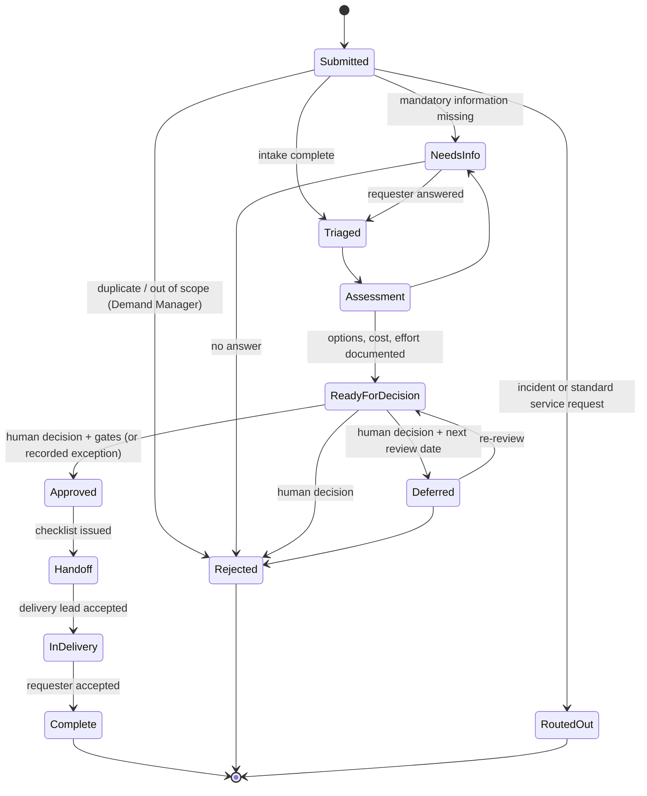

# Architecture, workflow and data model

## Overview

```mermaid
flowchart LR
    subgraph Local - offline, reproducible
        D[(data/synthetic<br/>demands, status events, decisions,<br/>budgets, invoices, purchase orders,<br/>capacity, allocations, options)]
        V[validator<br/>exception register]
        R[finance<br/>reconciliation + forecast]
        K[capacity + scoring<br/>gates, what-if]
        P[kpis + reports]
        M[Markdown reports + facts JSON]
        X[Excel workbook +<br/>Excel-formula exercise]
        S[Slide deck]
        W[Confluence page sources]
    end
    subgraph Atlassian Cloud - live, private site
        J[Jira project KAN<br/>50 demand issues]
        B[16 saved filters,<br/>dashboard, Kanban board]
        C[Confluence space<br/>static sections + live Jira macros]
    end
    D --> R --> V
    D --> K --> V
    V --> P --> M & X & S & W
    W -->|published once per cutoff| C
    D -->|seed plan, created once, idempotent| J
    J --> B
    J -->|JQL macros, live| C
    J -.->|recorded snapshot| Q[jira reconcile / jira live<br/>field comparison and drift]
    D -.-> Q
```

Reports never feed back into the sources. If a number is wrong, the source is corrected and everything is regenerated.

## Live and offline boundaries

| Component | Live or offline | Source of its figures | Refresh |
|---|---|---|---|
| Jira issues (status, priority, due date, labels, assignee) | live | seeded from the data set; Jira is the system of record for lifecycle afterwards | edited in Jira |
| Jira saved filters, dashboard, board | live | JQL over the issues | automatic in Jira |
| Confluence live Jira lists | live | Jira macros with JQL | on page view |
| Confluence financial tables, executive summary, decision brief | static snapshot | generated from the data set at the cutoff | republished per cutoff |
| Markdown reports, Excel workbooks, slide deck | offline | data set (CSV) | `python -m infraflow all` |
| Money and engineer-hours | offline only | finance and capacity ledgers; not stored in Jira (Free plan, no custom fields) | - |
| Jira vs. data set comparison | offline, on a recorded snapshot | snapshot from `jira pull` (REST, token) or the Atlassian connector | on demand |

There is no automatic synchronisation between Jira and the Office files. A difference between Jira and the data set is reported by `jira reconcile` (field by field) and `jira live` (lifecycle drift); on the recorded 2026-11-17 snapshot both report zero.

## Demand lifecycle



"Blocked" is a flag with a reason, not a status. Controls enforced by `lifecycle.py` (and tested): decisions need an authorised human role and a rationale; approval needs a gate evaluation; a failed funding or capacity gate needs an explicit exception rationale; a failed security gate cannot be overridden; deferral needs a review date; delivery needs a complete handoff; completion needs all required fields.

Jira mapping (project KAN has five statuses; the exact stage is a `stage-*` label):

| Lifecycle stage | Jira status |
|---|---|
| Submitted, Needs Info, Triaged | Idea |
| Assessment | To Do |
| Ready for Decision, Deferred | In Review |
| Approved, Handoff, In Delivery | In Progress |
| Complete, Rejected, Routed Out | Done |

## Modules (`src/infraflow`)

| Layer | Module | Responsibility |
|---|---|---|
| Configuration | `config.py` | Cutoff, cost centres, teams, lifecycle table, weights, Jira mapping |
| Data | `catalog.py`, `generator.py` | Hand-authored demand catalogue; deterministic datasets + by-construction ground truth |
| Domain | `models.py`, `lifecycle.py`, `scoring.py` | Records, tolerant loading, transitions and controls, score and gates |
| Calculation | `finance.py`, `capacity.py`, `validator.py`, `kpis.py` | Reconciliation and forecast, capacity and what-if, exception register, KPIs |
| Output | `reports.py`, `excel_export.py`, `excel_native.py`, `deck.py`, `confluence_pages.py` | Reports, workbook, Excel-formula exercise, slides, Confluence page sources |
| Office design and QA | `office_style.py`, `office_qa.py` | Shared palette and Excel chart helper; chart-structure checks and slide layout estimate; byte-reproducible Office files |
| Integration | `jira_client.py`, `jira_sync.py`, `jira_live.py` | REST client (dry-run default), seed plan, coverage, filters, reconciliation, read-only live view and drift |
| Interface | `cli.py` | `python -m infraflow ...` |

## Data model (`data/synthetic`)

| File | Key | Content |
|---|---|---|
| `demands.csv` | `external_id` | 50 demands: requester, site, category, scores, due date, status, owner, team, hours, cost centre, estimates, security, blocker, decision summary, handoff |
| `status_events.csv` | `event_id` | Append-only status history (actor role, previous and new status, reason) |
| `decisions.csv` | `decision_id` | One row per board decision: approver role, outcome, rationale, finance/capacity snapshot refs, follow-up |
| `options.csv` | `external_id` + `option_id` | Assessed options (hero demand) |
| `budgets.csv` | month + cost centre | Approved budget |
| `actuals.csv` | `invoice_id` | Invoices and credit notes; `po_id` links to a purchase order |
| `commitments.csv` | `po_id` | Purchase orders: approved, recognised, status |
| `capacity.csv` | month + team | Available and allocated hours |
| `allocations.csv` | month + team + demand | What the allocation consists of (`RUN` or a demand) |
| `ground_truth.json` | - | Independent expected totals and anomaly ids for the tests |

`external_id` (`ORION-REQ-NNN`) joins everything: Jira summary and label, invoices, purchase orders, allocations, decisions, reports. `data/jira_mapping.json` maps it to Jira keys.

Extensions to the specification's schema: `po_id` in `actuals.csv`, plus `allocations.csv` and `options.csv` (see `docs/DECISIONS.md` D-011).

## Formulas

- Priority score = 100 x (0.35 impact + 0.25 urgency + 0.25 risk reduction + 0.15 strategic) / 5.
- Open commitment = max(approved - recognised, 0), open purchase orders only.
- Forecast EAC = actual + open commitments + approved-not-committed. Variance = EAC - budget.
- Period cost of a demand = one-time + monthly x months after go-live inside the budget period.
- Funding gate: cost-centre EAC + period cost <= budget. Capacity gate: hours <= unallocated team hours from the cutoff month to the due month.
