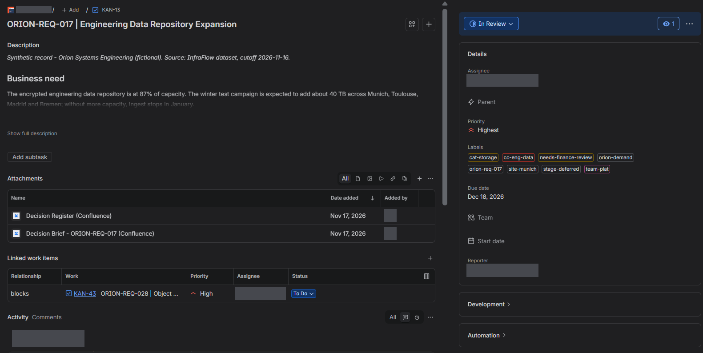
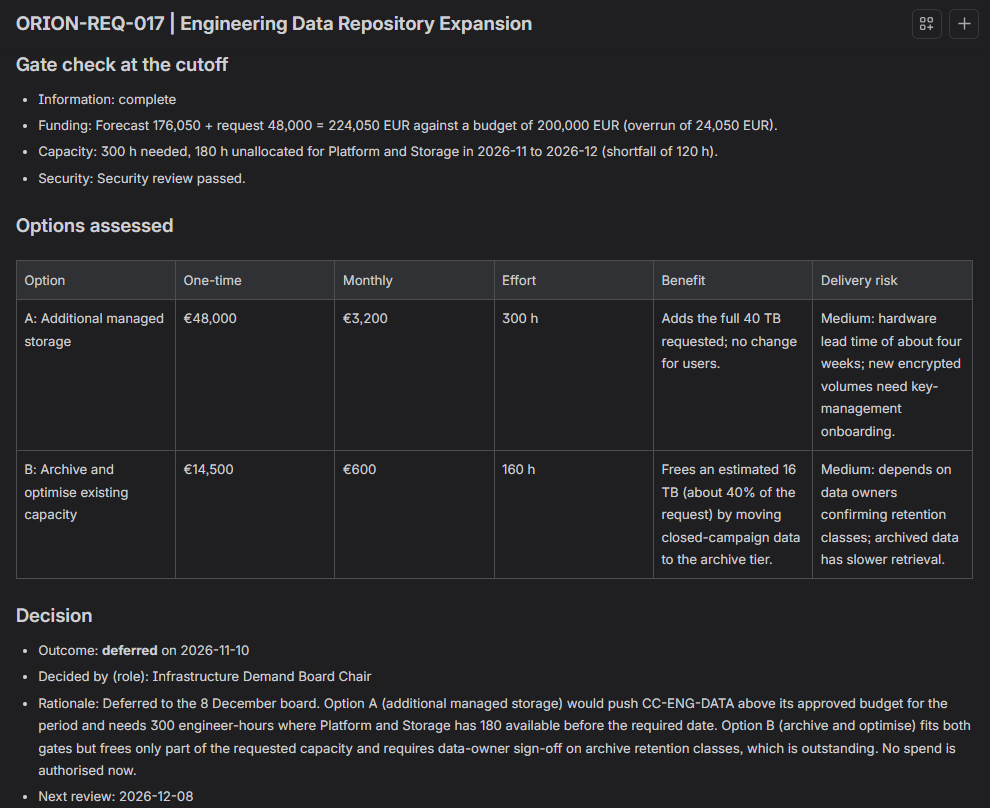
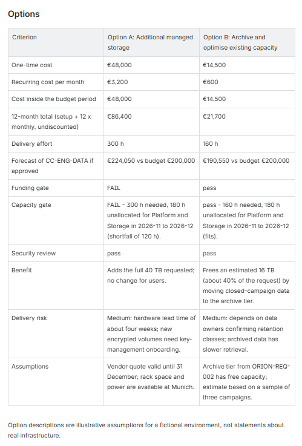
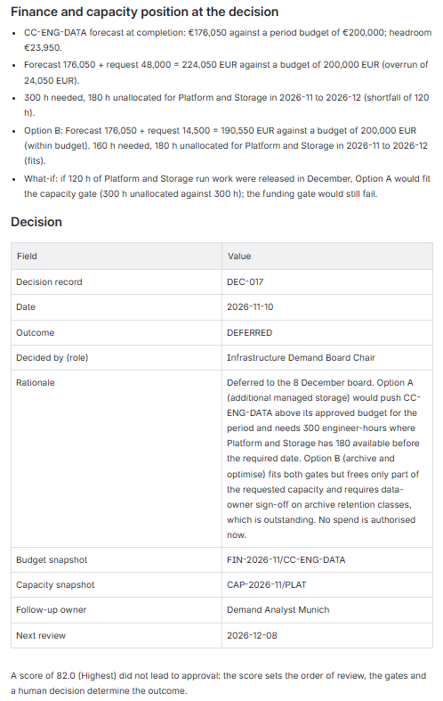
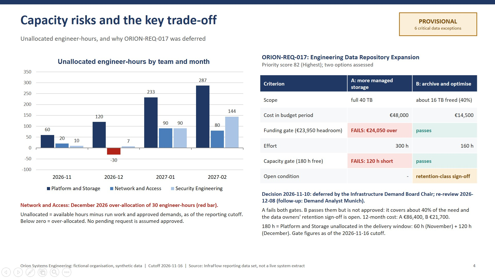

# Case study: ORION-REQ-017, Engineering Data Repository Expansion

**A top-priority request that was deferred, and why that was the right outcome.**

> Independent portfolio project using entirely synthetic data. All organizations, personnel, infrastructure demands, financial figures, and operational scenarios are fictional. This project is not affiliated with or endorsed by any real organization and has not been deployed in production.

All data is synthetic (fictional "Orion Systems Engineering"). Reporting cutoff 2026-11-16. Financial figures are provisional because six unrelated critical data exceptions are open in the portfolio. None of them is booked on this request's cost centre (CC-ENG-DATA), but the provisional status applies to every figure in the report.

| | |
|---|---|
| Jira | KAN-13, status In Review, label `stage-deferred` |
| Confluence | Decision Register, child page "Decision Brief - ORION-REQ-017" |
| Generated report | `reports/decision_brief_ORION-REQ-017.md` |
| Source records | `demands.csv`, `options.csv`, `status_events.csv`, `decisions.csv` (DEC-017), finance and capacity ledgers |

## 1. The request

The encrypted engineering data repository is at 87% of capacity. The winter test campaign will add about 40 TB across Munich, Toulouse, Madrid and Bremen; without more capacity, ingest stops in January.

| Field | Value |
|---|---|
| Requester (role) | Engineering Lead Flight Test Data Engineering, Munich |
| Business owner | Head of Flight Test Data Engineering |
| Required by | 2026-12-18 |
| Cost centre / delivery team | CC-ENG-DATA / Platform and Storage |
| Security review | required; passed |
| Risk if nothing is decided | ingest for the January campaign must be throttled |

*KAN-13 in Jira. The labels carry the exact lifecycle stage (`stage-deferred`), cost centre, site and team, which is what the saved filters and the dashboard use. The issue links to its Confluence decision records and "blocks" KAN-43 (ORION-REQ-028, object storage for satellite test imagery), which depends on this request. Personal account details are covered.*

## 2. Intake and history

| Date | Stage | Actor (role) | What happened |
|---|---|---|---|
| 2026-10-05 | Submitted | Engineering Lead | Submitted through the intake form |
| 2026-10-07 | Needs Info | Demand Analyst Munich | Retention classification and accountable business owner missing |
| 2026-10-14 | Triaged | Demand Analyst Munich | Retention class R3 (10 years) confirmed; business owner named |
| 2026-10-16 | Assessment | Demand Analyst Munich | Solution Architect asked for two options |
| 2026-11-03 | Ready for Decision | Solution Architect | Options assessed; finance and capacity snapshot references attached |
| 2026-11-10 | Deferred | Infrastructure Demand Board Chair | Deferred to the 8 December board |

The history is synthetic (`status_events.csv`). In Jira it appears as comments on KAN-13; the issue itself was created when the portfolio was seeded on 2026-11-17.

## 3. Priority score: orders the queue, does not decide

Score = 100 x (0.35 x impact + 0.25 x urgency + 0.25 x risk reduction + 0.15 x strategic fit) / 5, with analyst ratings 0-5:

100 x (0.35 x 5 + 0.25 x 4 + 0.25 x 3 + 0.15 x 4) / 5 = **82.0, band Highest**.

The score puts the request near the top of the board agenda. It does not approve anything (`scoring.py`; enforced by `lifecycle.py` and its tests).

## 4. Gates and options

Gates are evaluated at the reporting cutoff:

- **Funding:** cost-centre forecast at completion plus the request's cost in the budget period must not exceed the period budget. CC-ENG-DATA forecast €176,050, budget €200,000, headroom €23,950.
- **Capacity:** effort must fit into the team's unallocated hours from the cutoff month to the due month. Platform and Storage has 60 h (November) + 120 h (December) = **180 h**. An over-allocated month would count as zero.
- **Information** (complete) and **security** (passed) are satisfied.

*The gate check and both options are written into the Jira issue by the seeding code (`jira_sync.issue_payload`), from the same calculation that produces the reports.*

| | Option A: additional managed storage | Option B: archive and optimise existing capacity |
|---|---|---|
| One-time / monthly | €48,000 / €3,200 | €14,500 / €600 |
| Cost inside the budget period | €48,000 | €14,500 |
| 12-month total (setup + 12 x monthly) | €86,400 | €21,700 |
| CC-ENG-DATA forecast if approved | €224,050 vs €200,000 | €190,550 vs €200,000 |
| Funding gate | **FAIL** (€24,050 over) | pass |
| Effort vs. 180 h unallocated | 300 h, **FAIL** (120 h short) | 160 h, pass |
| Benefit | full 40 TB, no change for users | about 16 TB freed (40%) by archiving closed-campaign data |
| Delivery risk | hardware lead time about four weeks; key-management onboarding | depends on data owners confirming retention classes; slower retrieval of archived data |

*The Confluence decision brief carries the same table plus the assumptions behind each option. The brief notes that the options are illustrative assumptions for a fictional environment.*

## 5. The decision

| Field | Value |
|---|---|
| Decision record | DEC-017, 2026-11-10 |
| Outcome | **Deferred** to the 8 December board |
| Decided by (role) | Infrastructure Demand Board Chair |
| Rationale | A would push CC-ENG-DATA over its budget and needs 300 h where 180 h are available. B fits both gates but frees only part of the capacity and needs the data owners' sign-off on retention classes, which is outstanding. No spend is authorised now. |
| Snapshot references | FIN-2026-11/CC-ENG-DATA, CAP-2026-11/PLAT |
| Follow-up | Demand Analyst Munich prepares the re-review; next review 2026-12-08 |

*The decision as recorded in Confluence, with a what-if: releasing 120 h of December run work would let Option A pass the capacity gate, but funding would still fail.*

**Caveat on dates.** The Confluence heading says "position at the decision", but the figures are computed from the 2026-11-16 data snapshot, six days after the decision date. The synthetic data set does not contain a separate finance history for 2026-11-10; the snapshot references in the decision record name the documents a real board would have used.

*How the board sees it: slide 4 of the generated executive deck. In the chart, the red bar below zero is the December over-allocation of Network and Access (-30 h). In the table, red = gate failed, teal = gate passed, amber = open condition. The slide states that Option B is not approved even though it passes the gates.*

## 6. Why this matters

- **Priority is not permission.** The highest-scored items still go through funding, capacity, information and security gates and a named human decision.
- **Each figure can be traced.** Every number in the decision traces to a source record and a calculation that is covered by tests (`test_scoring.py`, `test_finance.py`, `test_capacity.py`, `test_reporting.py`).
- **Deferral is a managed outcome.** It carries a reason, a review date and an owner, and Jira and Confluence show the same state.
- **Alternatives are part of the decision.** The cheaper option is not chosen automatically; scope and open conditions are part of the decision.

## 7. Controls and limits

| Control | Where | Limit |
|---|---|---|
| Decision needs an authorised role and rationale | `lifecycle.py`, `test_lifecycle.py` | Enforced in the Python model; Jira Free has no workflow validators |
| Deferral needs a review date | `lifecycle.py` | Same |
| Gate results recomputed for every report | `scoring.py`, `finance.py`, `capacity.py` | Point-in-time at the cutoff, not at the decision date |
| Jira and data set agree | `jira reconcile`, `jira live` | Compared through recorded snapshots, not continuous sync |

Related: [demonstration gallery](DEMO.md) · [architecture](ARCHITECTURE.md) · [financial methodology](FINANCIAL_METHODOLOGY.md) · [README](../README.md)
