# Demonstration gallery

All 20 screenshots, captured by the author on 2026-11-17/18 from the private Atlassian site and from Microsoft Excel and PowerPoint. They are ordered by the question they answer. Click an image for full resolution.

> Independent portfolio project using entirely synthetic data. All organizations, personnel, infrastructure demands, financial figures, and operational scenarios are fictional. This project is not affiliated with or endorsed by any real organization and has not been deployed in production.

Everything shown is **synthetic** (fictional "Orion Systems Engineering"), with reporting cutoff **2026-11-16**. Financial figures are **PROVISIONAL** because six critical data exceptions are modelled on purpose. In the published copies the account holder's name, avatar initials and the Jira space name are covered with flat grey blocks; nothing else was changed (log: `evidence/screenshots/REDACTION_LOG.json`).

**Contents:** [1. Portfolio status in Jira](#1-what-is-the-state-of-the-portfolio-jira) · [2. One request end to end](#2-how-was-one-request-decided-orion-req-017) · [3. Weekly management review](#3-what-does-management-read-each-week-confluence) · [4. Money and capacity](#4-are-we-within-budget-and-capacity-excel) · [5. Executive briefing](#5-what-does-the-board-see-powerpoint-slides-1-to-5)

---

## 1. What is the state of the portfolio? (Jira)

### Open demands by status and priority

<a href="../evidence/screenshots/01-jira-dashboard-status-priority.png">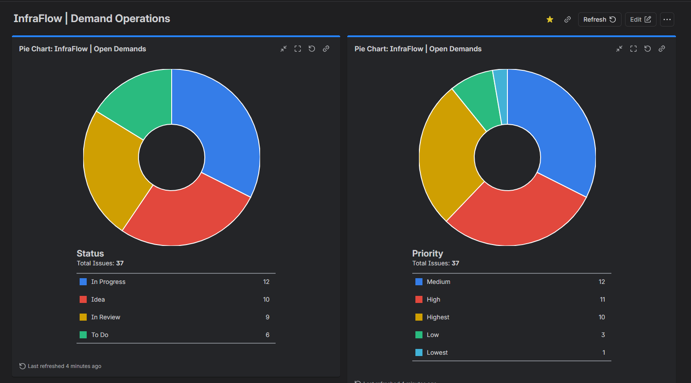</a>

Dashboard "InfraFlow | Demand Operations", built from saved JQL filters. The 37 open demands are split by workflow status and by priority. Both totals match the offline reports for the same cutoff. Gadgets read the live project, so counts move when issues change.

### What needs management attention

<a href="../evidence/screenshots/02-jira-dashboard-management-attention.png">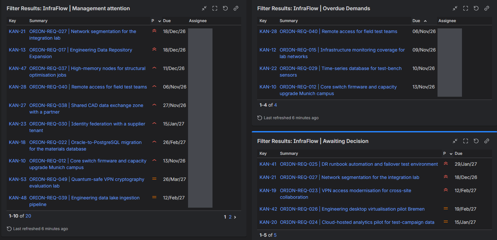</a>

The same dashboard shows three action lists:
- **Management attention:** 20 demands that are overdue, unowned, blocked or need a finance review.
- **Overdue:** 4 demands.
- **Awaiting a board decision:** 5 demands.

Each list is one saved filter from the [JQL catalogue](JQL_FILTERS.md). The assignee column is covered because the site has a single licensed user, the author. Role-level ownership is recorded in each issue description.

### Open demands by team, site, cost centre and review flag

<a href="../evidence/screenshots/03-jira-dashboard-status-team-matrix.png">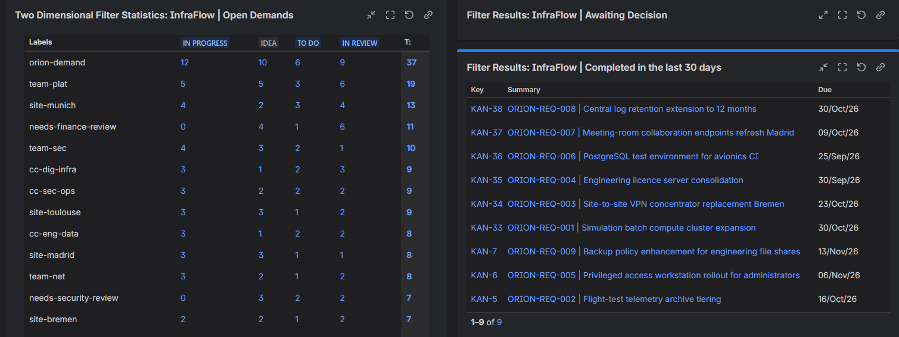</a>

Status crossed with labels: delivery team, site, cost centre, and finance or security review flags. Rows overlap, because one demand carries several labels, so only the `orion-demand` row (37) is a total. On the right, the nine demands completed in the last 30 days.

### Blocked or deferred work

<a href="../evidence/screenshots/04-jira-dashboard-blocked-deferred.png">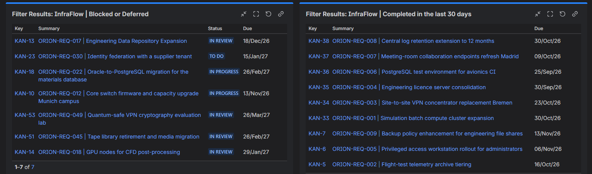</a>

Seven demands are blocked (with a reason in the issue) or deferred (with a review date). ORION-REQ-017 (KAN-13) is one of them. The completed list repeats the previous image.

### The board

<a href="../evidence/screenshots/05-jira-kanban-portfolio.png">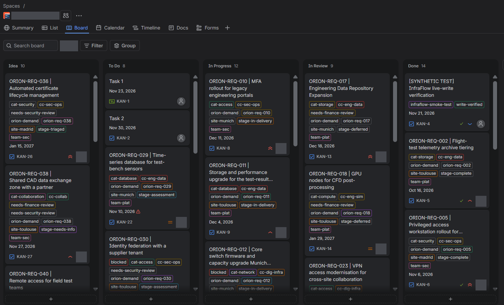</a>

Kanban board with five columns. Twelve lifecycle stages map onto these five statuses, and the exact stage is a `stage-*` label (mapping in [architecture](ARCHITECTURE.md)). Column counts include the non-portfolio items visible on the board ("Task 1", "Task 2" and the "[SYNTHETIC TEST]" record). That is why To Do shows 8 and Done 14, while the portfolio has 6 and 13.

---

## 2. How was one request decided? (ORION-REQ-017)

The full story is in the [case study](CASE_STUDY_ORION_REQ_017.md). The four screenshots below are the evidence it uses.

### The work item

<a href="../evidence/screenshots/06-jira-orion017-overview-links.png">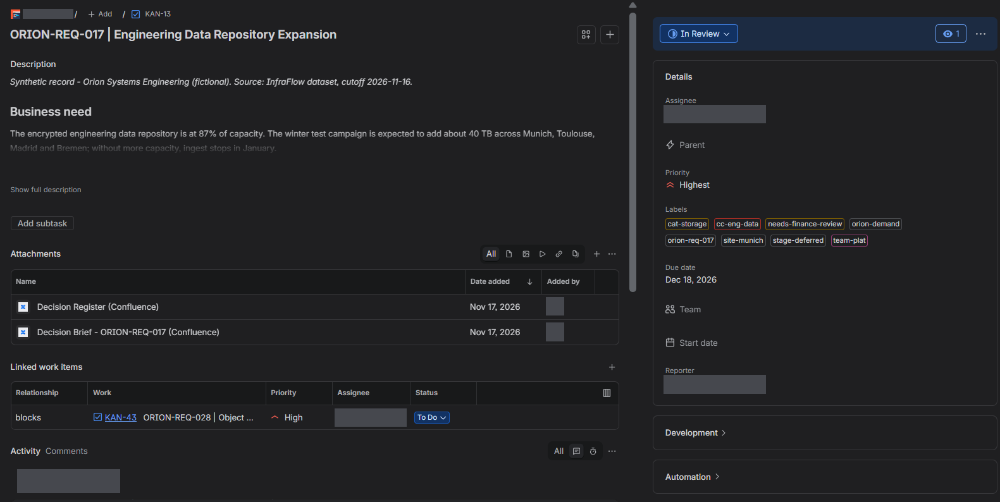</a>

KAN-13 carries:
- **Status and priority:** In Review, Highest.
- **Labels:** `stage-deferred`, `needs-finance-review`, `cc-eng-data`, `site-munich`, `team-plat`.
- **Due date:** 18 Dec 2026.
- **Links:** the Confluence decision register and decision brief, and a dependency, it "blocks" KAN-43.

The description is collapsed in this capture; the next image shows it expanded.

### Gate check, options and decision in the issue

<a href="../evidence/screenshots/07-jira-orion017-gates-options-decision.png">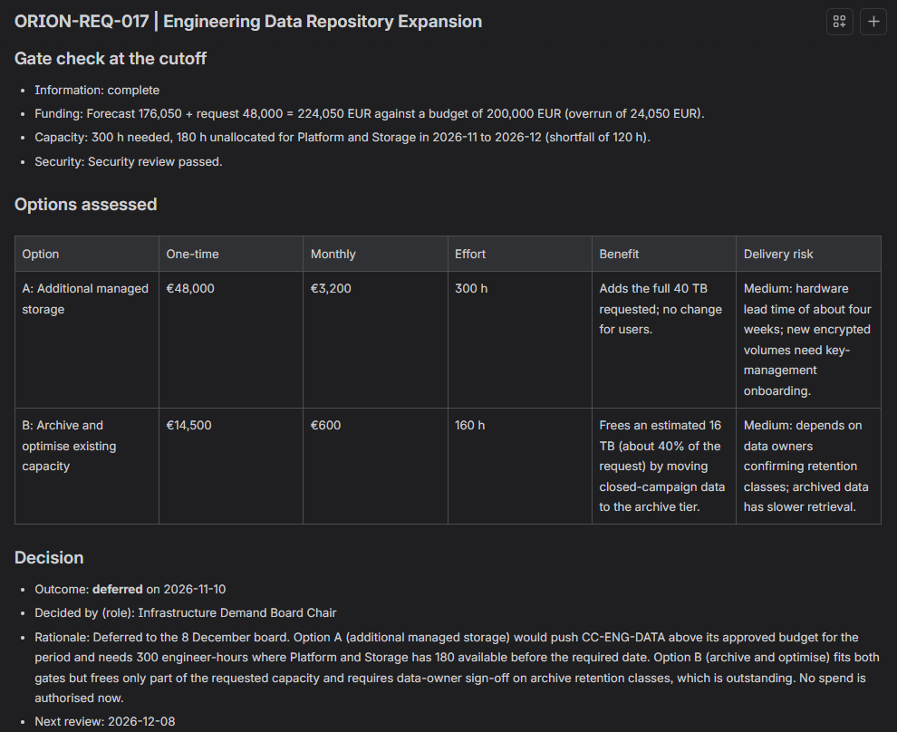</a>

The issue description is generated from the data set:
- the gate check at the cutoff;
- both options with cost, effort, benefit and delivery risk;
- the recorded decision: role, rationale and next review.

Dates in the issue's comment history reconstruct the synthetic lifecycle; the issue itself was created on 2026-11-17.

### Decision brief in Confluence

<a href="../evidence/screenshots/08-confluence-orion017-options.png">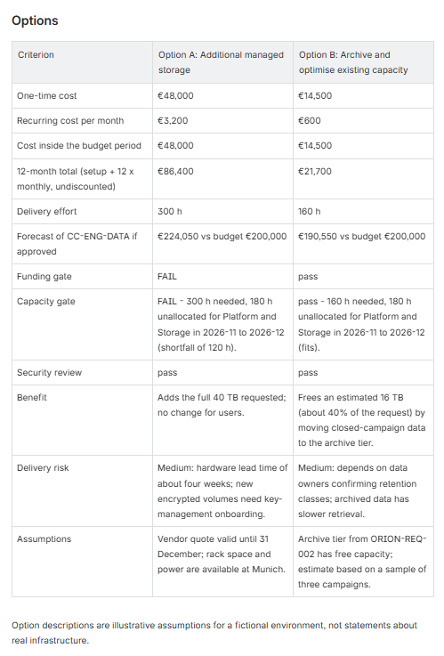</a>

<a href="../evidence/screenshots/09-confluence-orion017-decision.png">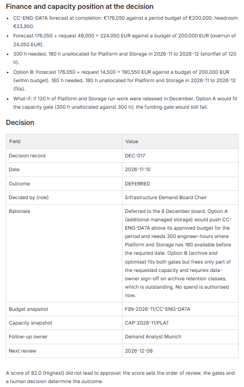</a>

The decision brief, a child page of the Decision Register:
- **Options table (first image):** for each option, the effect on the cost-centre forecast and the result of every gate.
- **Decision record (second image):** DEC-017, plus a what-if: if 120 h of run work were released in December, Option A would pass capacity but still fail funding.

The heading "position at the decision" shows figures computed from the 2026-11-16 data snapshot. The data set has no separate finance history for the decision day.

---

## 3. What does management read each week? (Confluence)

<a href="../evidence/screenshots/10-confluence-weekly-review-overview.png">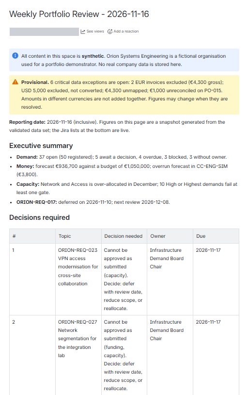</a>

<a href="../evidence/screenshots/11-confluence-weekly-review-actions.png">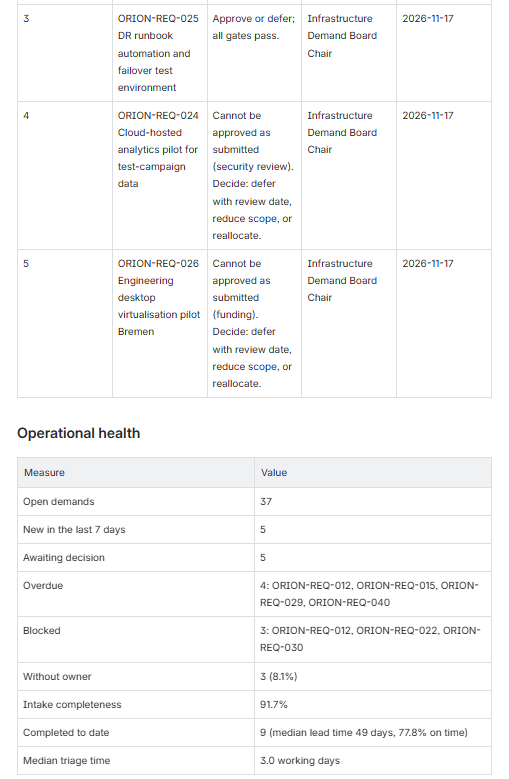</a>

The weekly review page:
- a synthetic-data notice;
- the **PROVISIONAL** warning, listing each excluded amount in its own currency (EUR invoices €4,300 gross; USD 5,000 not converted; €4,300 unmapped; €1,000 unreconciled on PO-015);
- an executive summary, the five decisions with owner and date, and operational health figures.

The author byline is covered.

<a href="../evidence/screenshots/12-confluence-weekly-financial-status.png">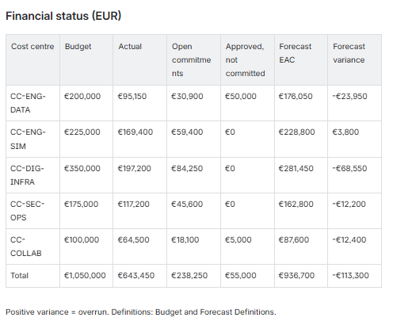</a>

The financial table on the same page is a **static snapshot** generated from the offline data set, not live Jira data:
- total budget €1,050,000;
- forecast €936,700;
- CC-ENG-SIM €3,800 over.

The image is shown at its natural size.

<a href="../evidence/screenshots/13-confluence-live-jira-tables.png">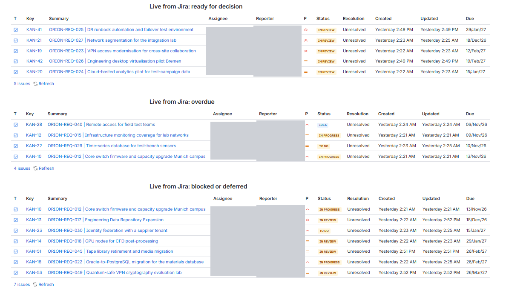</a>

The bottom of the same page holds **live** Jira lists, as Confluence Jira macros with JQL: ready for decision (5), overdue (4) and blocked or deferred (7). Live lists and the static figures sit side by side, and the page says which is which. Assignee and reporter columns are covered.

---

## 4. Are we within budget and capacity? (Excel)

<a href="../evidence/screenshots/14-excel-forecast-workbook.png">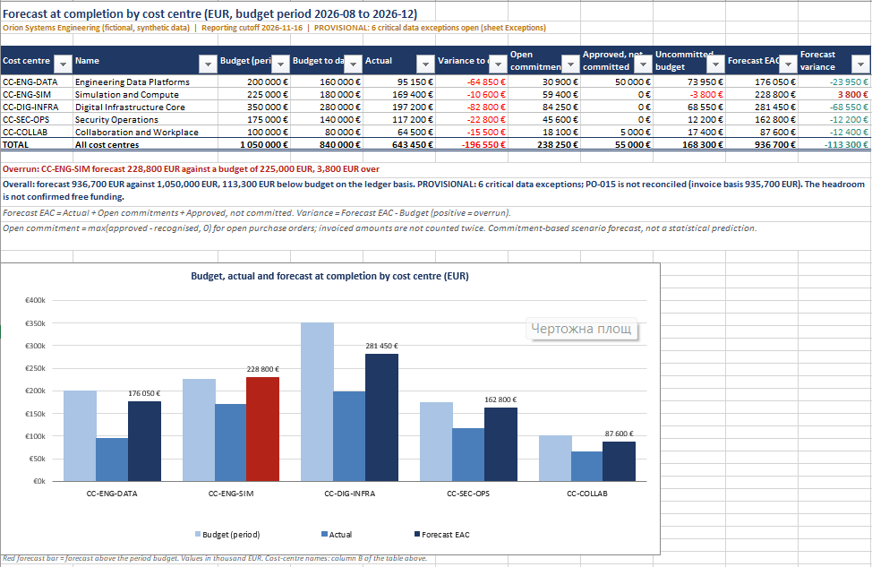</a>

The generated management workbook, Forecast sheet, in Microsoft Excel:
- the cost-centre table with budget, budget to date, actual, commitments, uncommitted budget, forecast and variance;
- the overrun line;
- the provisional note: six exceptions; PO-015 not reconciled, with the invoice basis of €935,700; "the headroom is not confirmed free funding";
- a native chart in which the over-budget forecast bar is red.

The floating label inside the chart is an Excel tooltip captured with the screenshot.

<a href="../evidence/screenshots/15-excel-capacity-workbook.png">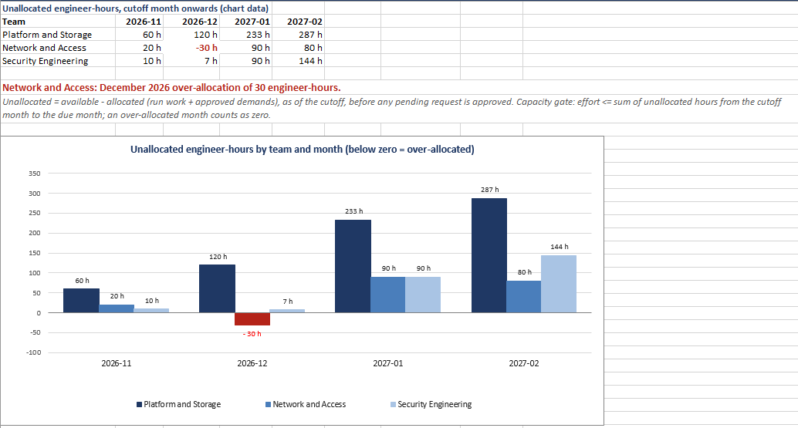</a>

The Capacity sheet shows unallocated engineer-hours per team and month as of the cutoff, before any pending request is approved. Network and Access is 30 h over-allocated in December 2026: the red bar below the zero line. The capacity gate adds unallocated hours from the cutoff month to the due month, and an over-allocated month counts as zero.

The separate Excel-formula workbook (SUMIFS, COUNTIFS, INDEX/MATCH, conditional formatting) is not shown in a screenshot. Microsoft Excel calculated all 27 of its check cells as OK (`evidence/excel_desktop_native_checks_2026-11-17.json`).

---

## 5. What does the board see? (PowerPoint, slides 1 to 5)

The five-slide executive briefing is generated with python-pptx and uses native, editable charts. Every slide carries the PROVISIONAL tag and the synthetic-data footer.

### Slide 1 - Portfolio overview

<a href="../evidence/screenshots/19-ppt-portfolio-overview-slide1.png">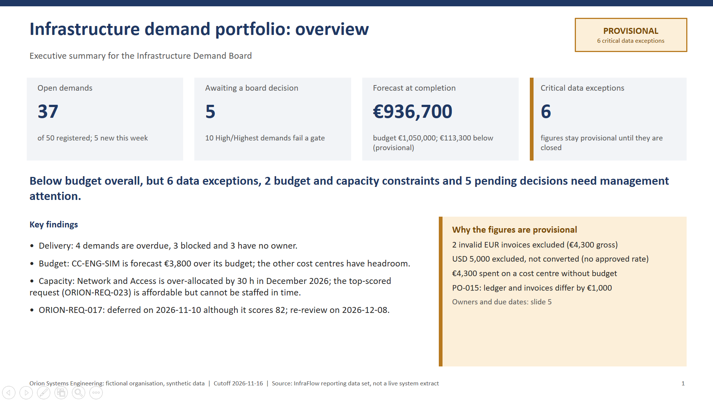</a>

The slide has:
- four KPIs;
- one headline: below budget overall, but exceptions, constraints and decisions need attention;
- key findings, and a panel explaining why the figures are provisional.

The slideshow navigation icons at bottom left come from PowerPoint's presentation view.

### Slide 2 - Demand pipeline and operational performance

<a href="../evidence/screenshots/18-ppt-demand-pipeline-slide2.png">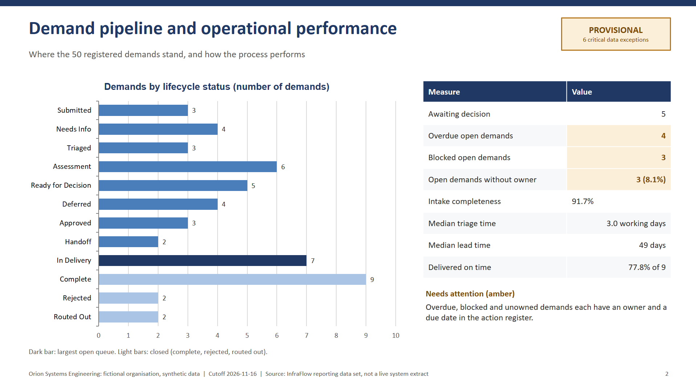</a>

All 50 demands by lifecycle stage; the largest open queue is dark and closed stages are light. Overdue, blocked and unowned counts are amber.

### Slide 3 - Budget, actuals, commitments and forecast

<a href="../evidence/screenshots/17-ppt-financial-briefing-slide3.png">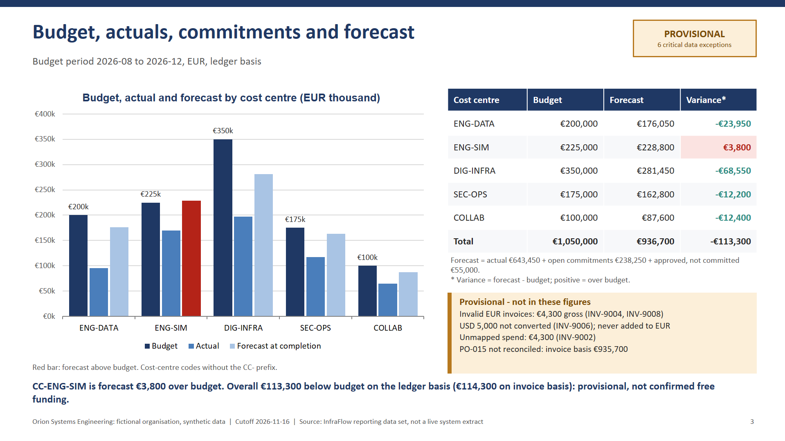</a>

The slide has:
- forecast per cost centre, built from actual + commitments + approved work without purchase order;
- a variance table;
- an amber box listing everything outside the figures, each amount in its own currency.

The headline states the €113,300 headroom on the ledger basis (€114,300 on invoice basis) as *provisional, not confirmed free funding*.

### Slide 4 - Capacity risks and the key trade-off

<a href="../evidence/screenshots/16-ppt-capacity-decision-slide4.png">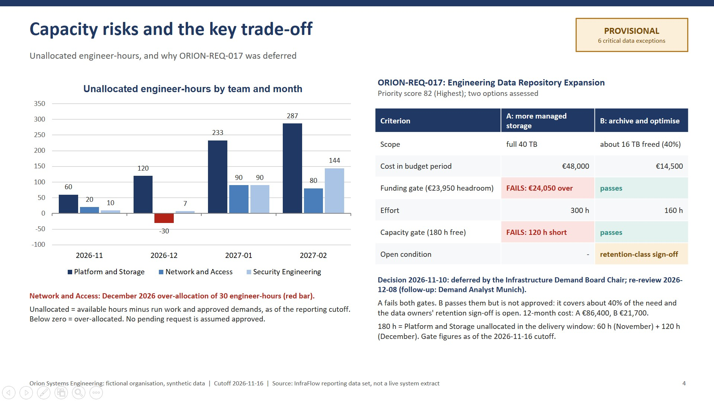</a>

Team capacity is shown next to the ORION-REQ-017 options. The December -30 h bar of Network and Access is red, below the zero line.
- red = gate failed, teal = gate passed, amber = open condition;
- the 180 h are explained as 60 h (November) + 120 h (December);
- the decision date (2026-11-10) is distinguished from the reporting cutoff (2026-11-16).

### Slide 5 - Decisions, responsibilities and next steps

<a href="../evidence/screenshots/20-ppt-board-decisions-slide5.png">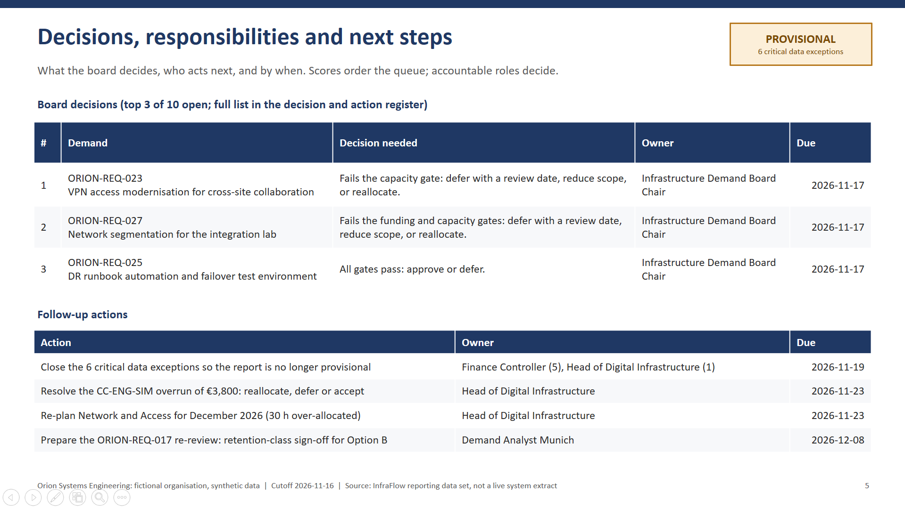</a>

The three most important board decisions, each with a one-line decision, an accountable role and a due date. Below them, follow-up actions with owners, including closing the six critical data exceptions that keep the report provisional.
